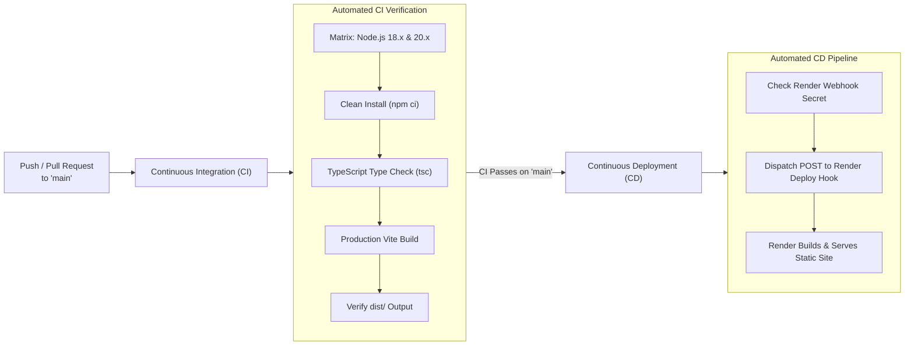

# 🚰 AquaGuard: Smart Water Tank Automation & Quality Monitoring System

<div align="center">

[](https://vitejs.dev/)
[](https://reactjs.org/)
[](https://www.typescriptlang.org/)
[](https://tailwindcss.com/)
[](https://firebase.google.com/)
[](https://www.espressif.com/)
[](https://github.com/features/actions)
[](https://render.com/)
[](https://opensource.org/licenses/MIT)

**An intelligent closed-loop IoT water reservoir management platform featuring real-time telemetry, optical turbidity quality verification, anti-tampering interlocks, fail-safe cloud synchronization, and an interactive 3D digital twin.**

[Live Demo](#-hosting--deployment-guide) • [Architecture](#-system-architecture) • [Hardware BOM](#-hardware-specifications--pinout) • [Local Setup](#-getting-started-locally) • [Security Guide](#-protecting-important-data--security)

---

</div>

## 📌 Table of Contents

1. [Overview & Problem Statement](#-overview--problem-statement)
2. [Core Features](#-core-features)
3. [System Architecture](#-system-architecture)
4. [Hardware Specifications & Pinout](#-hardware-specifications--pinout)
5. [Protecting Important Data & Security](#-protecting-important-data--security)
6. [Getting Started Locally](#-getting-started-locally)
7. [Deploying to GitHub](#-deploying-to-github)
8. [Continuous Integration & Continuous Deployment (CI/CD)](#-continuous-integration--continuous-deployment-cicd)
9. [Hosting on Render](#-hosting-on-render)
10. [Project Structure](#-project-structure)
11. [Engineering Team & Institutional Attribution](#-engineering-team--institutional-attribution)
12. [License](#-license)

---

## 🌊 Overview & Problem Statement

Domestic and industrial overhead water tanks encounter severe operational vulnerabilities:
- **Catastrophic Overflow & Water Waste**: Mechanical float switches often jam from scale deposits, leading to continuous overflow and motor burnout.
- **Contaminated Municipal Inflow**: Heavy rains and pipeline fractures introduce suspended silt, microbial pathogens, and high-turbidity water directly into clean storage tanks before detection.
- **Dry-Run Pump Failures**: Submersible pumps frequently run dry during municipal supply cuts, causing motor overheating and coil burnout.
- **Lid Tampering & Airborne Ingress**: Unmonitored tank access enables biological contamination (rodents, dust, airborne pollutants) to go unnoticed.

**AquaGuard** resolves these challenges through an autonomous, dual-core **ESP32** microcontroller running **FreeRTOS** alongside an enterprise-grade **React + TypeScript** web dashboard. The system continuously validates water quality before permitting intake, isolates pumps during dry-run or low-level anomalies, streams live metrics via **Google Firebase Realtime Database (RTDB)**, and includes an offline **hardware physics simulation engine** that allows seamless testing without physical hardware.

---

## ⚡ Core Features

### 🔄 1. Dual-Mode Telemetry Engine
- **Hardware Live Mode**: Streams two-way operational telemetry (water level %, turbidity NTU, lid status, actuator states) via Firebase RTDB with sub-100ms latency.
- **Autonomous Simulation Mode**: High-fidelity physics-based software simulation engine reproducing water intake dynamics, residential consumption patterns, turbidity spikes, and sensor faults whenever hardware is offline.

### 🧊 2. 3D Digital Twin Reservoir Visualizer
- Real-time 3D rendered water tank featuring dynamic liquid wave oscillation, volumetric fill calculations, live status badges, and color-coded turbidity states (Clear, Moderate, High, Severe Contamination).

### 🛡️ 3. Multi-Tier Sensor Interlocks
- **Optical Turbidity Sensing**: Samples analog optical attenuation through ADC1 with **64-sample median filtering** to filter out electromagnetic motor noise.
- **Solid-State Dual HW-038 Immersion Probes**: 20% (LOW) and 90% (FULL) liquid level sensing utilizing a **5ms pulsed energization cycle** to eliminate electrolytic galvanic corrosion.
- **IR Obstacle & Intrusion Detection**: Instant non-contact optical lid detection triggering local audible alarms and disabling intake pumps upon tampering.

### ⚙️ 4. Intelligent Actuator Failsafes
- **12V DC Solenoid Inlet Gate Valve**: Automatically clamps shut if incoming water exceeds turbidity thresholds (> 25 NTU / < 2.5V sensor reference).
- **Submersible Booster Pump**: Features software anti-chatter hysteresis, minimum dry-run lockout thresholds (20%), and continuous run-timer watchdogs.
- **Local Alarm System**: 85 dB piezo buzzer and high-contrast status LEDs operate autonomously on Core 1 even if cloud Wi-Fi connectivity drops.

### 📊 5. Telemetry Historian & Event Audit Logging
- Interactive time-series charts (turbidity trends, fill cycles, water usage) powered by Recharts.
- Complete chronological audit log of all system alarms, manual overrides, and valve switching events.
- Modern dark/light theme toggle, mobile mockup view, and responsive design for smartphones, tablets, and desktop workstations.

---

## 🏛️ System Architecture

```mermaid
flowchart TD
    subgraph HardwareLayer["Physical IoT Hardware Layer (Overhead Reservoir)"]
        HW038["HW-038 Dual Probes\n(LOW: 20% | FULL: 90%)"]
        TURB["Optical Turbidity Sensor\n(5V Analog Conditioning)"]
        IR["IR Obstacle Sensor\n(Lid Intrusion Detection)"]
        
        ESP["ESP32 DevKit V1\n(Dual-Core 240 MHz FreeRTOS)"]
        
        DIV["Resistive Voltage Divider\n(5V to 3.3V Step-down)"]
        RELAY["Dual Optocoupler Relay Module\n(Galvanic 2500V Isolation)"]
        SOL["12V DC Solenoid Valve\n(Municipal Inlet)"]
        PUMP["Mini DC Submersible Pump\n(Distribution Booster)"]
        BUZZ["Active 85 dB Piezo Buzzer\n& Dual Status LEDs"]
        
        HW038 -->|GPIO34 / GPIO35| ESP
        TURB --> DIV -->|GPIO32 (ADC1_CH4)| ESP
        IR -->|GPIO27| ESP
        
        ESP -->|GPIO25| RELAY --> SOL
        ESP -->|GPIO26| RELAY --> PUMP
        ESP -->|GPIO23 / 18 / 19| BUZZ
    end

    subgraph CloudLayer["Cloud & Telemetry Gateway"]
        RTDB[("Firebase Realtime Database\n(JSON Telemetry Store)")]
        ESP <-->|"TLS / WPA2 Wi-Fi (Core 0)"| RTDB
    end

    subgraph ClientLayer["Presentation & Control Layer (Render Hosted)"]
        DASH["AquaGuard Web Application\n(React 18 + TypeScript + Vite)"]
        SIM["Realistic Simulation Engine\n(Offline Fallback)"]
        
        RTDB <-->|"WebSocket / REST Live Sync"| DASH
        SIM -.->|"Autonomous Fallback"| DASH
    end
```

---

## 🔌 Hardware Specifications & Pinout

### Bill of Materials (BOM)

| Item | Component | Model / Spec | Purpose | Est. Cost |
| :-- | :--- | :--- | :--- | :--- |
| 1 | **Microcontroller** | ESP-WROOM-32 DevKit V1 (30-pin) | Real-time dual-core control & Wi-Fi telemetry | ₹420 |
| 2 | **Water Level Probes** | HW-038 Gold Immersion Plates (x2) | Low (20%) & Full (90%) level detection | ₹110 |
| 3 | **Turbidity Sensor** | Optical Turbidity Sensor Module | Silt / sediment detection & quality validation | ₹380 |
| 4 | **Lid Tamper Sensor** | IR Obstacle Reflection Sensor | Lid removal / unauthorized access alarm | ₹45 |
| 5 | **Relay Module** | 2-Channel 5V Optocoupler Relay | Galvanic high-power switching isolation | ₹95 |
| 6 | **Inlet Valve** | 12V DC 1/2" Solenoid Valve (NC) | Automated shut-off for municipal supply | ₹280 |
| 7 | **Booster Pump** | 12V Mini Submersible Water Pump | Water distribution & aeration | ₹140 |
| 8 | **Audible / Visual** | 5V Piezo Buzzer + Red/Green LEDs | On-site fail-safe audio & visual status indicators | ₹35 |
| 9 | **Protection** | 10kΩ & 20kΩ 1/4W Resistors | Voltage divider (5V sensor to 3.3V ESP32 ADC) | ₹10 |
| **Total** | | | **Complete Hardware Prototype BOM** | **~₹1,515** |

### ESP32 GPIO Pin Mapping

| ESP32 Pin | Direction | Signal Type | Target Peripheral | Description |
| :--- | :--- | :--- | :--- | :--- |
| **GPIO 32** | INPUT | Analog (ADC1_CH4) | Turbidity Sensor Output | Optical attenuation reading (64-sample median filter) |
| **GPIO 34** | INPUT | Digital (Pull-Down) | HW-038 LOW Level Probe | Triggers refill sequence at 20% capacity |
| **GPIO 35** | INPUT | Digital (Pull-Down) | HW-038 FULL Level Probe | Triggers auto cutoff sequence at 90% capacity |
| **GPIO 27** | INPUT | Digital (Active LOW) | IR Obstacle Sensor | Detects lid open / unauthorized intrusion |
| **GPIO 21** | OUTPUT | Digital Pulsed | Probe Power Gate | 5ms pulse drive to mitigate galvanic oxidation |
| **GPIO 25** | OUTPUT | Digital (Active LOW) | Relay CH1 (Solenoid Valve) | Opens/closes 12V municipal water inlet |
| **GPIO 26** | OUTPUT | Digital (Active LOW) | Relay CH2 (Water Pump) | Controls distribution pump with dry-run protection |
| **GPIO 23** | OUTPUT | Digital HIGH | 5V Active Piezo Buzzer | Audible warning for contamination or tampering |
| **GPIO 18** | OUTPUT | Digital HIGH | Green 5mm LED | Steady illumination indicating healthy system state |
| **GPIO 19** | OUTPUT | Digital HIGH | Red 5mm LED | Flashing illumination during active alarms |

---

## 🔒 Protecting Important Data & Security

Before uploading this project to GitHub or hosting it on Render, sensitive data must be strictly isolated to prevent leakage of API keys, database credentials, or project environment secrets.

### 1. Robust `.gitignore` Implementation
The repository includes a comprehensive `.gitignore` file that prevents accidental commits of:
- **Environment variables**: `.env`, `.env.local`, `.env.production`
- **Dependencies**: `node_modules/`
- **Build artifacts & caches**: `dist/`, `.vite/`, `*.tsbuildinfo`
- **Private keys & credentials**: `*.pem`, `*.key`, `serviceAccountKey*.json`
- **Operating system files**: `.DS_Store`, `Thumbs.db`

### 2. Using `.env.example` as a Template
All secrets are decoupled using Vite environment variables prefixed with `VITE_`. A safe template `.env.example` is committed to the repository:

```env
# Copy this file to '.env' for local development or enter into Render dashboard
VITE_FIREBASE_API_KEY=your_firebase_api_key_here
VITE_FIREBASE_AUTH_DOMAIN=your_project_id.firebaseapp.com
VITE_FIREBASE_DATABASE_URL=https://your_project_id-default-rtdb.firebaseio.com
VITE_FIREBASE_PROJECT_ID=your_project_id
VITE_FIREBASE_STORAGE_BUCKET=your_project_id.appspot.com
VITE_FIREBASE_MESSAGING_SENDER_ID=your_messaging_sender_id
VITE_FIREBASE_APP_ID=your_app_id
```

> [!NOTE]
> **Firebase is fully optional**: If no Firebase credentials are provided, AquaGuard automatically and seamlessly defaults to its built-in realistic simulation mode. The project will compile, build, and run without runtime crashes!

### 3. Firebase Database Security Rules
When deploying a Firebase Realtime Database for production hardware, secure your database rules so unauthorized users cannot alter relay states or override safety triggers:

```json
{
  "rules": {
    "telemetry": {
      ".read": true,
      ".write": "auth != null"
    },
    "controls": {
      ".read": "auth != null",
      ".write": "auth != null"
    },
    "messages": {
      ".read": "auth != null",
      ".write": true
    }
  }
}
```

---

## 💻 Getting Started Locally

### Prerequisites
- **Node.js**: v18.0.0 or higher
- **npm**: v9.0.0 or higher (or `pnpm` / `yarn`)
- **Git** installed on your system

### Quick Installation

1. **Clone the repository**:
   ```bash
   git clone https://github.com/YOUR_USERNAME/AquaGuard.git
   cd AquaGuard
   ```

2. **Install project dependencies**:
   ```bash
   npm install
   ```

3. **Configure Environment Variables (Optional)**:
   ```bash
   # Copy the safe template to .env
   cp .env.example .env
   ```
   *Edit `.env` with your Firebase credentials if you are connecting physical ESP32 hardware, or leave them empty to run in realistic simulation mode.*

4. **Launch the development server**:
   ```bash
   npm run dev
   ```
   Open your browser at `http://localhost:5173` to explore the dashboard.

5. **Test the Production Build**:
   ```bash
   npm run build
   npm run preview
   ```

---

## 🚀 Deploying to GitHub

Follow these steps to safely push your project to GitHub without leaking secrets:

### Step 1: Verify Git Status
Run the following command to ensure that `node_modules`, `dist`, and `.env` are **not** staged:
```bash
git status
```
*You should only see source files (`src/`, `public/`, `package.json`, `render.yaml`, `README.md`, etc.).*

### Step 2: Stage and Commit the Files
```bash
git add .
git commit -m "feat: complete AquaGuard smart tank platform with Render config & docs"
```

### Step 3: Link Remote and Push to GitHub
```bash
# Rename branch to main if not already on main
git branch -M main

# Add your GitHub repository remote (replace with your URL)
git remote add origin https://github.com/YOUR_USERNAME/AquaGuard.git

# Push code to GitHub
git push -u origin main
```

---

## ⚙️ Continuous Integration & Continuous Deployment (CI/CD)

The repository features an enterprise-grade automated CI/CD pipeline powered by **GitHub Actions** ([`.github/workflows/ci-cd.yml`](.github/workflows/ci-cd.yml)).



### 1. Continuous Integration (CI Job)
- **Triggers**: Every `push` and `pull_request` targeting the `main` branch.
- **Matrix Testing**: Validates code builds against both **Node.js 18.x** and **Node.js 20.x** LTS environments.
- **Type Safety Verification**: Runs `npm run typecheck` (`tsc --noEmit`) to verify zero TypeScript errors.
- **Production Compilation**: Executes `npm run build` and asserts that `dist/index.html` is generated properly without missing assets.
- **Artifact Archival**: Uploads the compiled `dist/` bundle as a verified GitHub Action artifact.

### 2. Continuous Deployment (CD Job)
- **Automatic Deployment Trigger**: Once the CI verification passes on `main`, the CD job notifies Render to initiate an immediate zero-downtime production deployment.
- **Render Webhook Setup (Optional)**:
  1. In your [Render Dashboard](https://dashboard.render.com/), open your `aquaguard-smart-tank` Static Site.
  2. Navigate to **Settings** > **Deploy Hook** and copy the unique webhook URL (e.g. `https://api.render.com/deploy/srv-xxxxxx?key=yyyyyy`).
  3. In your GitHub repository, navigate to **Settings** > **Secrets and variables** > **Actions** > **New repository secret**.
  4. Name the secret `RENDER_DEPLOY_HOOK_URL` and paste the URL.
  *(Note: If you have Render's native 'Auto-Deploy' enabled, Render also deploys automatically on every push! The workflow safely handles both modes).*

---

## 🌐 Hosting on Render

AquaGuard can be deployed on [Render](https://render.com/) as a high-performance **Static Site** in two simple ways:

### Option A: 1-Click Blueprint Deploy (`render.yaml`)

This repository includes a pre-configured `render.yaml` Blueprint file.

1. Sign in to your [Render Dashboard](https://dashboard.render.com/).
2. Click **New +** and select **Blueprint**.
3. Connect your GitHub repository (`AquaGuard`).
4. Render will automatically parse `render.yaml` and configure the build command (`npm run build`), publish directory (`dist`), and SPA rewrites (`/* -> /index.html`).
5. (Optional) Enter your `VITE_FIREBASE_*` environment variables when prompted.
6. Click **Apply** to deploy!

---

### Option B: Manual Static Site Setup

If you prefer to configure manually via the Render UI:

1. In the Render Dashboard, click **New +** > **Static Site**.
2. Connect your GitHub repository.
3. Configure the following build parameters:

   | Setting | Value |
   | :--- | :--- |
   | **Name** | `aquaguard-smart-tank` |
   | **Branch** | `main` |
   | **Root Directory** | *(Leave blank)* |
   | **Build Command** | `npm run build` |
   | **Publish Directory** | `dist` |

4. **Configure Environment Variables** (Under the *Environment* tab):
   Add any required variables:
   - `VITE_FIREBASE_API_KEY`
   - `VITE_FIREBASE_AUTH_DOMAIN`
   - `VITE_FIREBASE_DATABASE_URL`
   - `VITE_FIREBASE_PROJECT_ID`
   - `VITE_FIREBASE_STORAGE_BUCKET`
   - `VITE_FIREBASE_MESSAGING_SENDER_ID`
   - `VITE_FIREBASE_APP_ID`

   *(If left empty, the application runs in simulation mode flawlessly!)*

5. **Configure Single Page Application (SPA) Rewrites**:
   - Go to **Redirects/Rewrites** in the Render site settings.
   - Add a rule:
     - **Type**: `Rewrite`
     - **Source**: `/*`
     - **Destination**: `/index.html`
   *(This ensures client-side routes such as `#dashboard` or subpaths never return 404 errors on browser reload).*

6. Click **Create Static Site**. Render will compile and launch your site with free SSL (`https://aquaguard-smart-tank.onrender.com`).

---

## 📂 Project Structure

```
Aqua Guard/
├── .github/
│   └── workflows/
│       └── ci-cd.yml            # Automated GitHub Actions CI/CD pipeline
├── .git/                        # Git version control metadata
├── .gitignore                   # Excludes secrets (.env), node_modules, dist
├── .env.example                 # Safe environment variables template
├── render.yaml                  # Render Blueprint Infrastructure-as-Code
├── index.html                   # HTML5 entry template & Google Fonts
├── package.json                 # Project dependencies and build scripts
├── postcss.config.js            # PostCSS configuration for Tailwind
├── tailwind.config.js           # Custom theme colors, gradients, dark mode
├── tsconfig.json                # TypeScript compiler configuration
├── vite.config.ts               # Vite build and plugin configuration
│
├── public/                      # Static assets served as-is
│   ├── _redirects               # SPA rewrite fallback for Render/Netlify
│   └── assets/
│       └── components/          # High-resolution hardware component photos & SVGs
│
└── src/
    ├── main.tsx                 # React DOM mount point
    ├── App.tsx                  # Root component, hash router, and global state
    ├── index.css                # Global Tailwind directives & custom utilities
    │
    ├── components/              # Modular UI components
    │   ├── Navbar.tsx           # Navigation bar with connection status & theme toggle
    │   ├── Hero.tsx             # Interactive hero showcase with telemetry pills
    │   ├── LiveDashboardPage.tsx# Dedicated real-time monitoring page
    │   ├── FullCircuitPage.tsx  # Interactive interactive hardware schematic & pin viewer
    │   ├── ProjectInfoPage.tsx  # Institutional credentials & capstone team attribution
    │   ├── HardwareSection.tsx  # Component cards with modal deep-dives
    │   ├── HardwareDetailModal.tsx # Detailed hardware datasheets & wiring diagrams
    │   ├── MobileMockup.tsx     # Smartphone container previewing live mobile UI
    │   ├── FlowDiagram.tsx      # Multi-stage fluid flow and sensor decision chart
    │   ├── FAQSection.tsx       # Technical Q&A on fail-safes & FreeRTOS loops
    │   ├── ContactPage.tsx      # Team feedback form with Firebase sync
    │   ├── PrivacyNoticePage.tsx# Privacy & IoT data compliance documentation
    │   ├── TermsOfUsePage.tsx   # Engineering safety terms and usage protocols
    │   └── Dashboard/           # Telemetry dashboard sub-components
    │       ├── LiveDashboard.tsx    # Master telemetry monitor grid
    │       ├── TankGauge3D.tsx      # 3D fluid tank visualizer with wave physics
    │       ├── TurbidityGauge.tsx   # Analog/digital NTU quality meter
    │       ├── IRSensorCard.tsx     # Anti-tampering lid sensor indicator
    │       ├── ActuatorControls.tsx # Manual pump/solenoid overrides with safety interlocks
    │       ├── ChartsSection.tsx    # Recharts time-series telemetry historian
    │       ├── SimulationPanel.tsx  # Simulation control sandbox for testing edge cases
    │       └── EventLogTable.tsx    # Filterable chronological audit logger
    │
    ├── context/                 # React Context providers
    │   └── TankContext.tsx      # Shared state management for tank telemetry
    │
    ├── data/                    # Static datasets
    │   └── hardwareData.ts      # Hardware specifications, GPIO wiring, and ESP32 code
    │
    ├── services/                # Core business logic & cloud integrations
    │   ├── firebase.ts          # Firebase SDK initialization with fallback safeguards
    │   ├── simulationEngine.ts  # Realistic water physics and fault simulation engine
    │   └── tankService.ts       # Unified telemetry manager (Firebase <-> Simulation)
    │
    └── types/                   # TypeScript interfaces and domain models
        ├── index.ts             # Generic component types
        ├── tank.ts              # Tank state, events, telemetry, and alarm types
        └── three.d.ts           # Type definitions for 3D visualization components
```

---

## 👥 Engineering Team & Institutional Attribution

This project was developed as an undergraduate Capstone Engineering Project at **Thiagarajar College of Engineering (TCE)**:

- **Institution**: [Thiagarajar College of Engineering](https://www.tce.edu/), Madurai – 625 015, Tamil Nadu, India.
  *(Autonomous Institution Affiliated to Anna University, Approved by AICTE, Accredited by NAAC with 'A+' Grade)*
- **Department**: Department of Electronics and Communication Engineering (ECE)
- **Academic Year**: 2025 – 2026
- **Project Designation**: Capstone Prototype Team 5

### Project Team Members

| Name | Role | Primary Engineering Responsibilities |
| :--- | :--- | :--- |
| **Kiruthik Sabari S** | **Team Leader** | ESP-WROOM-32 FreeRTOS firmware architecture, 64-sample median ADC1 filtering, and dual-probe debounce state machines. |
| **Srivardhini** | **System Designer** | Mechanical enclosure design, fluid manifold layout, 3D transparent reservoir visualization, and UI/UX ergonomics. |
| **Aswatha Priya B** | **Web Master** | Full-stack responsive React/TypeScript dashboard, bi-directional Firebase RTDB synchronization, and telemetry historian charts. |
| **Palanisamy K** | **Recorder** | Technical documentation, Bill of Materials (BOM) cost optimization, component datasheets, and experimental test logs. |
| **Harikumar M** | **Devil's Advocate** | Quality assurance, fault-injection testing (dry-run stalls, sensor disconnects, power spikes), and fail-safe safety interlocks. |

---

## 📜 License

This project is licensed under the **MIT License** — see the [LICENSE](LICENSE) file for full details.

```
Copyright (c) 2026 Team 5 - Department of Electronics and Communication Engineering,
Thiagarajar College of Engineering, Madurai, India.
```

Permission is hereby granted, free of charge, to any person obtaining a copy of this software and associated documentation files to deal in the Software without restriction, including without limitation the rights to use, copy, modify, merge, publish, distribute, sublicense, and/or sell copies of the Software.

---

<div align="center">
  <b>AquaGuard &bull; Clean Water &bull; Intelligent Automation &bull; Zero Waste</b>
</div>
